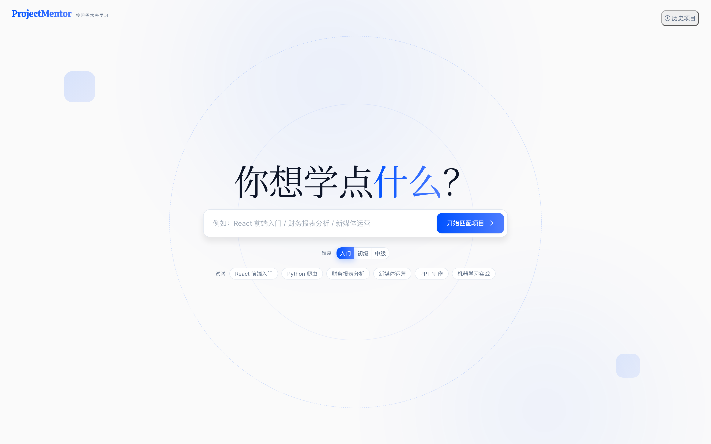
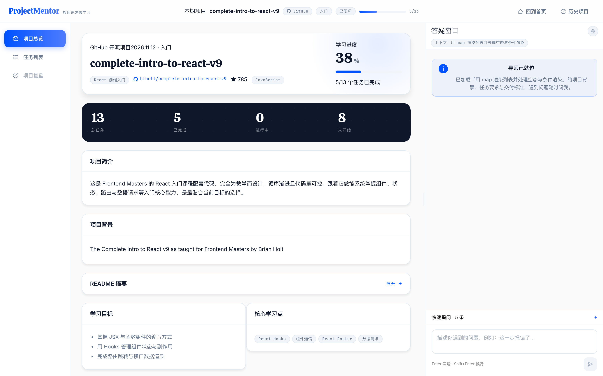
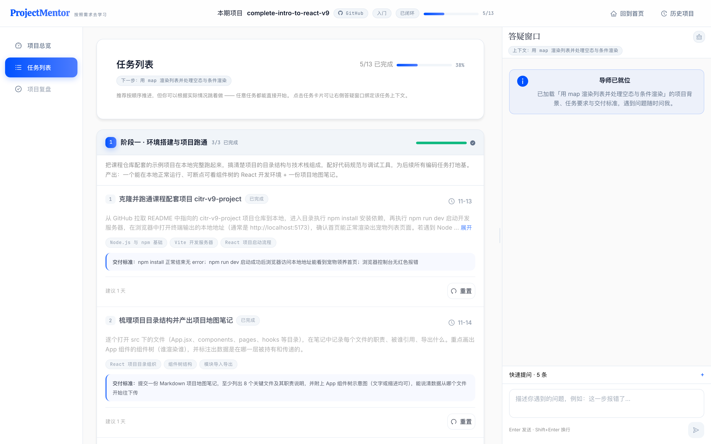
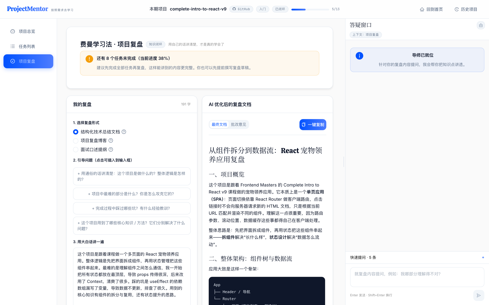

# ProjectMentor — PBL 项目制 AI 实战导师

**输入一个学习方向，得到一个能真正做完的实战项目 —— 不是课程大纲，而是带 DDL 的任务、随时在线的导师，和一次真正检验理解程度的复盘。**

[](https://github.com/zqyt05/project-mentor/actions/workflows/ci.yml)
[](https://www.python.org/)
[](https://react.dev/)
[](https://fastapi.tiangolo.com/)
[](LICENSE)

---

## 目录

- [解决什么问题](#解决什么问题)
- [核心功能](#核心功能)
- [技术栈](#技术栈)
- [快速启动](#快速启动)
- [项目结构](#项目结构)
- [几个关键的工程决策](#几个关键的工程决策)
- [已知限制](#已知限制)
- [License](#license)

---

## 解决什么问题

在校学生和转行者学技术时，普遍卡在同一个地方：**看完了教程，但做不出东西**。

- 课程给的是**知识地图**（先学 A，再学 B），不是**交付物**（做出一件东西）
- 学完不知道自己会不会，因为没有检验环节
- 遇到问题没人可问，或者只能问通用 AI，得不到结合当前任务的回答

ProjectMentor 想复刻的是**企业里导师带新人的方式**：直接给一个真实项目做，
做的过程中答疑，做完讲一遍给导师听，导师指出你的理解偏差。

产品上有三个刻意的设计：

| 设计 | 理由 |
| --- | --- |
| **只输出项目，不输出课程大纲** | 项目自带完成标准，做完就是学会 |
| **每个任务带 DDL 与交付标准** | 没有截止日的学习计划等于没有计划 |
| **用费曼学习法收尾** | 能讲清楚才是真学会，讲不清楚说明没懂 |

---

## 核心功能

### 1. 双路径项目智能匹配

输入学习方向 + 难度，系统先判断领域类型，再走两条路径之一：

| 路径 | 触发条件 | 做法 |
| --- | --- | --- |
| **A · GitHub 开源项目** | 技术开发类方向 | 检索优质仓库 → 逐条评估对学习者的适配度 → 提取 README 摘要 |
| **B · AI 定制项目** | 通用能力类方向 | 按方向与难度生成「小而实」的实战项目 |

**关键技术点**：中文方向（如「React 前端入门」）直接拿去搜 GitHub 命中率极低。
所以领域判断这一步会**同时产出英文技术关键词和语言限定** —— 一次调用解决三件事。

优质开源项目不足 3 个时**不整体降级**，而是用 AI 定制项目补齐差额 ——
即使只找到 1–2 个高度相关的仓库，也仍然呈现给用户。

### 2. 项目拆解 + DDL 任务管理

选中项目后，AI 把项目拆成 **4–6 个阶段**、共 13–14 个任务，每个任务包含：

- 具体做什么（可执行的描述）
- 需掌握的知识点
- **可判断真假的交付标准**（不是「理解 XX」，而是「四列齐全无空行，差额为 0」）
- 建议天数与截止日期（DDL 按顺序累加）

任务**推荐按顺序推进，但不强制** —— 任意任务都能直接开始。
自主学习者可能已经掌握某部分、或想先看后面的任务再回头补，硬性门禁会把人卡住。

### 3. 双窗口隔离式场景化答疑

左侧主任务窗口 + 右侧独立答疑窗口，**分栏比例可拖拽调整**（默认 70/30，双击复位）。

关键设计：**每个任务的对话完全隔离**。
右上角的答疑上下文自动绑定当前任务，切换任务时加载该任务独立的对话历史，
且**永远不会冲掉**左侧的任务记录。

历史对话按最近 12 条截断 —— 再多的上下文收益有限，反而会稀释当前任务的焦点。

### 4. 费曼学习法复盘

全部任务完成后进入复盘环节，用「结构化技术总结 / 项目复盘博客 / 面试口述提纲」
三种形式之一，让学习者**用自己的话讲一遍**，AI 从四个维度处理：

| 维度 | 做什么 |
| --- | --- |
| 理解纠错 | 找出说错的地方，给出正确表述 |
| 遗漏补全 | 补充没提到但重要的知识点 |
| 结构优化 | 把零散的表述整理成有逻辑的文档 |
| 深化建议 | 指出可以继续深挖的方向 |

输出一份**可展示的复盘文档**，支持一键复制。

### 5. 历史项目与进度管理

所有项目持久化在本地，支持查看进度、继续学习、删除。
顶栏实时显示当前项目的完成度。

---

## 界面预览


| 首页：极简搜索 | 项目总览 |
| --- | --- |
|  |  |

| 任务列表（含交付标准与 DDL） | 费曼复盘 |
| --- | --- |
|  |  |

---

## 技术栈

| 层级 | 技术选型 | 说明 |
| --- | --- | --- |
| 前端 | React 18 + TypeScript 5.7 + Vite 5 | 主流前端栈，TS 严格模式 |
| 前端 UI | Ant Design 5 | Layout 天然支持双窗口分栏 |
| 前端状态 | Zustand 5 | 轻量全局状态，承载双窗口联动 |
| 前端路由 | react-router-dom 6 | 首页独立全屏，其余页面走双窗口外壳 |
| 内容渲染 | react-markdown + remark-gfm + highlight.js | 渲染答疑与复盘文档，支持表格与代码高亮 |
| 后端 | Python 3.11 + FastAPI 0.143 | 全异步链路，自动生成 OpenAPI 文档 |
| ORM | SQLAlchemy 2.1（2.0 声明式风格） | SQLite，WAL 模式 |
| AI 编排 | LangChain 1.4 + langchain-openai 1.7 | 对接 DeepSeek 的 OpenAI 兼容接口 |
| AI 模型 | DeepSeek `deepseek-flash` | 推理模型，1M 上下文 |
| 第三方集成 | GitHub REST API v3 | 技术类项目检索与 README 校验 |
| 静态检查 | flake8（F 类语义检查）+ ESLint 8 + tsc | 见 [CI 配置](.github/workflows/ci.yml) |
| 容器化 | Docker 多阶段构建 + Compose | 前后端同源，镜像 451 MB |
| 环境管理 | pydantic-settings | 敏感信息全部走环境变量，禁止硬编码 |

---

## 快速启动

### 方式一：本地开发

```bash
# 准备配置
cp backend/.env.example backend/.env
# 编辑 backend/.env，填入 DEEPSEEK_API_KEY（必填）与 GITHUB_TOKEN（可选）

# 终端 1：后端（首次运行自动建表）
./scripts/start-backend.sh

# 终端 2：前端
./scripts/start-frontend.sh
```

打开 <http://127.0.0.1:5173>

依赖环境：Python 3.11、Node ≥ 22.13、pnpm。

### 方式二：Docker

```bash
docker compose up -d --build     # 构建并后台启动
docker compose logs -f           # 看日志
docker compose down              # 停止（保留数据卷）
```

打开 <http://127.0.0.1:8000>


## 项目结构

```
ProjectMentor/
├── backend/
│   ├── app/
│   │   ├── api/            # 路由层：只做参数校验与响应封装
│   │   │   ├── auth.py         # 演示门禁（口令登录、访客身份）
│   │   │   ├── project.py      # 项目匹配、详情、删除
│   │   │   ├── task.py         # 阶段/任务、状态流转、进度
│   │   │   ├── chat.py         # 答疑（按任务隔离的会话）
│   │   │   └── review.py       # 费曼复盘
│   │   ├── services/       # 业务逻辑层：可脱离 FastAPI 单测
│   │   │   ├── project_service.py    # 匹配 / 拆解 / 进度计算
│   │   │   ├── chat_service.py       # 上下文拼装与对话
│   │   │   ├── review_service.py     # 复盘生成
│   │   │   ├── llm_service.py        # DeepSeek 封装（含配额收口点）
│   │   │   ├── github_service.py     # GitHub 检索
│   │   │   ├── auth_service.py       # 口令与签名 Cookie
│   │   │   └── usage_service.py      # 每日 AI 调用配额
│   │   ├── models/         # SQLAlchemy 模型（6 张表）
│   │   ├── schemas/        # Pydantic 请求/响应
│   │   ├── prompts/        # 6 个 Prompt 模板（当代码资产管理）
│   │   └── utils/response.py # 统一 {code,message,data} 与全局异常处理
│   ├── tests/              # 111 个离线单测
│   └── requirements.txt
├── frontend/
│   └── src/
│       ├── api/            # axios 封装（统一解包、401 拦截、FormData）
│       ├── components/     # ProjectCard / TaskCard / StageTimeline / Reveal …
│       ├── layout/         # MainLayout（可拖拽分栏）/ TopBar / SideMenu / ChatPanel
│       ├── pages/          # Home / Login / Match / Overview / Tasks / Review / History
│       ├── store/          # Zustand（应用状态 + 鉴权状态）
│       └── index.css       # 设计系统（CSS 变量 + 工具类 + AntD 覆写）
├── scripts/                # 启动、演示、隧道、Key 检查
├── docs/                   # 部署指南、架构说明、截图
├── Dockerfile / docker-compose.yml
└── .github/workflows/ci.yml
```


---

## 已知限制

| 限制 | 说明 |
| --- | --- |
| 单用户本地工具 | 无账号体系。演示模式用共享口令 + 访客隔离，不是完整多租户 |
| 无数据库迁移 | 使用 `create_all`，**不会**给已有表加列。模型变更后需删库重建（有真实数据后应引入 Alembic） |
| SQLite | 适合单用户/小范围试用。并发写入已开 WAL + busy_timeout |
| 长请求同步返回 | 项目匹配 13–43s、任务拆解约 51s、复盘约 36s。没有流式输出，靠缓动进度条缓解等待焦虑 |
| 前端包 1.5 MB（gzip 465 KB） | AntD 全量引入，未做按需加载与代码分割 |
| 无前端单测 | 目前靠浏览器端到端验证 + TypeScript 类型系统兜底 |

---

## License

[MIT](LICENSE) © 2026 zqyt05
