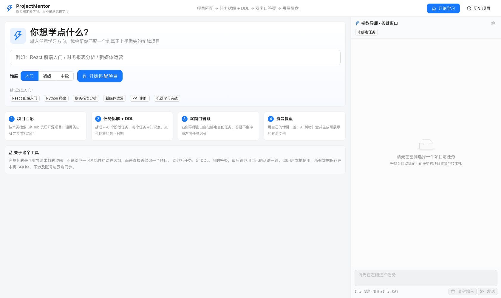
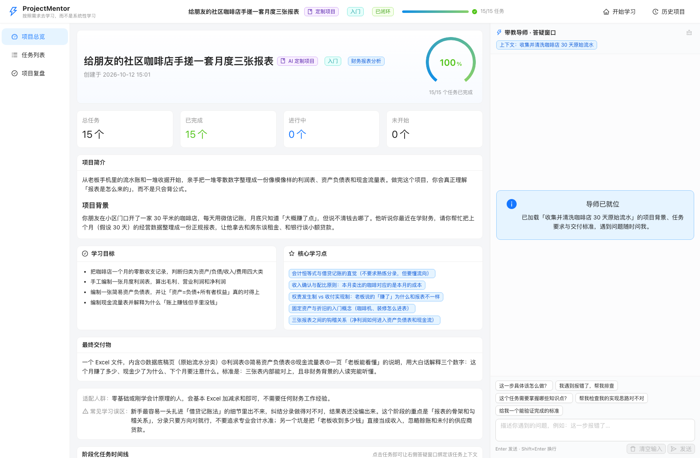
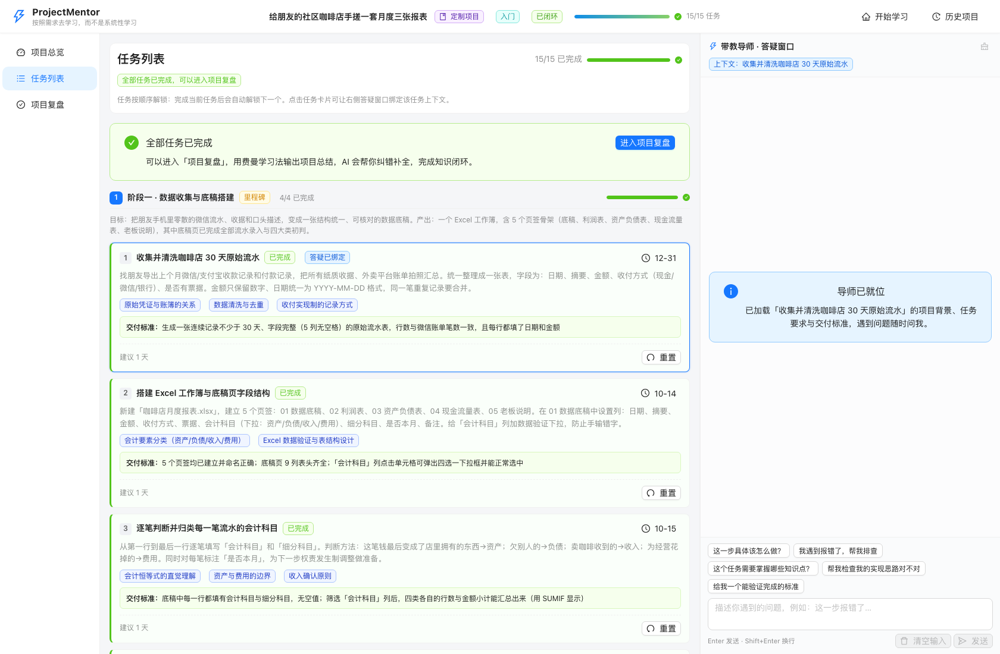
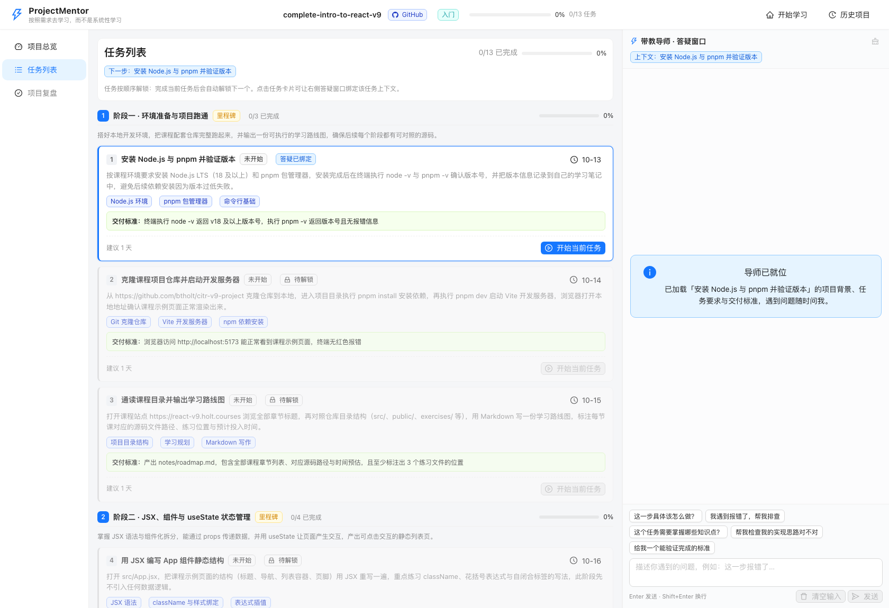
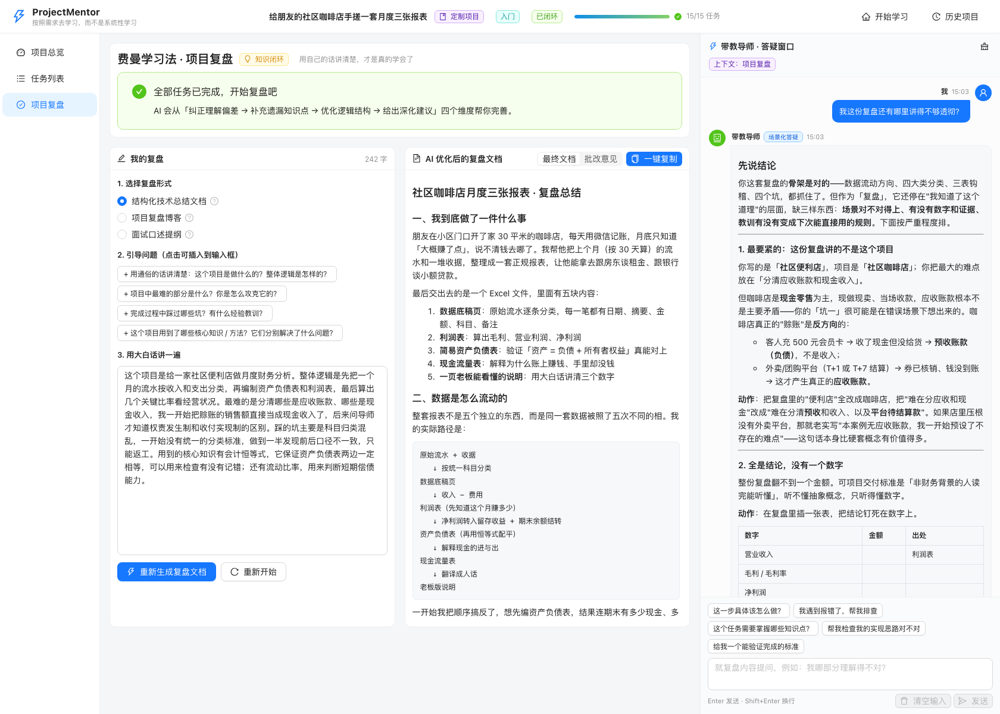
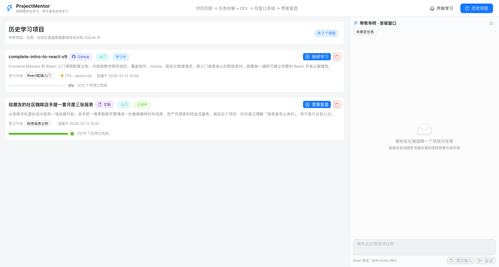

# ProjectMentor — PBL 项目制 AI 实战导师

> **「按照需求去学习，而不是系统性学习。」**

面向全领域学习者的通用 AI 实战学习工具，复刻企业导师带教逻辑，以「做项目」为核心学习方式，
提供 **项目匹配 → 任务拆解 + DDL → 双窗口隔离答疑 → 费曼复盘输出** 的完整学习闭环。

- **技术编程类方向** → 优先检索 GitHub 优质开源项目做实战
- **通用知识领域**（金融、运营、职场、学科等）→ AI 生成定制化实战项目

---

## 目录

- [解决什么问题](#解决什么问题)
- [核心功能](#核心功能)
- [界面截图](#界面截图)
- [技术栈](#技术栈)
- [快速启动](#快速启动)
- [开发与测试](#开发与测试)
- [项目结构](#项目结构)
- [架构说明](#架构说明)
- [API 一览](#api-一览)
- [常见问题](#常见问题)

> 📖 详细文档：[快速启动指南](docs/快速启动指南.md) · [架构说明](docs/架构说明.md) · [开发版 PRD](docs/开发版PRD.md)

---

## 解决什么问题

| 学习痛点 | ProjectMentor 的做法 |
| --- | --- |
| 想学新技术，但不知道练什么项目 | 输入学习方向，自动匹配 GitHub 开源项目或生成定制实战项目 |
| 盲目自学，学完只会概念 | 每个项目都有明确交付物，交付标准可判断 |
| 缺少导师督促、缺少 DDL 约束 | 拆解为 4-6 个阶段任务，每个任务带知识点、交付标准与 DDL |
| 答疑工具答得泛泛，脱离场景 | 答疑窗口自动绑定当前任务的项目背景、技术栈与交付标准 |
| 单窗口对话混乱，任务记录被冲刷 | 主任务窗口与答疑窗口物理隔离，任务链路永不被聊天冲掉 |
| 学完不会复盘，无法形成闭环 | 费曼学习法复盘：用自己的话讲一遍，AI 纠错补全并生成文档 |

---

## 核心功能

### 1. 双路径项目智能匹配

输入学习方向 + 难度，系统自动判断领域类型并选择最优路径：

```
用户输入学习方向 + 难度
    ↓
AI 判断领域类型（技术开发类 / 通用知识类）
    ├─ 技术类 → GitHub 检索（Star > 500、近一年有更新、README 完整）
    │             → AI 逐条评估适配度 → 按难度匹配度排序输出 Top 5
    └─ 通用类 / 技术类但优质项目 < 3 个
                  → AI 生成 3 个定制实战项目
    ↓
项目卡片列表（名称 / 来源 / 难度 / 推荐理由 / 核心学习点 / 交付物）
```

- **路径 A（GitHub）**：调用 GitHub REST API v3 检索，由 DeepSeek 生成推荐理由、适配人群、
  核心技术点、练习侧重点、常见学习误区，并按难度匹配度打分排序
- **路径 B（AI 定制）**：生成「小而实、有明确交付物」的项目，例如
  「编制小型便利店月度资产负债表并做简要分析」
- **自动降级**：技术类方向如果检索不到 3 个优质项目，自动降级到路径 B

### 2. 项目拆解 + DDL 任务管理

把项目拆解为 **4-6 个学习阶段**，每个阶段 **3-5 个具体任务**，每个任务包含：
任务名称、任务描述、需掌握知识点、交付标准、建议 DDL 天数。

- DDL 按任务顺序自动累加计算（项目开始日 + 累计建议天数）
- 支持**手动调整任意任务的 DDL 日期**
- **顺序门禁**：完成当前任务后自动解锁下一个，跳步开始会被拦截
- 进度总览：整体进度条 + 阶段进度 + 逾期提醒

### 3. 双窗口隔离式场景化答疑

固定左右分栏，**左侧主任务窗口约 70%，右侧独立答疑窗口约 30%**：

| | 左侧主任务窗口 | 右侧答疑窗口 |
| --- | --- | --- |
| 职责 | 纯展示与任务操作 | 仅提问与解答 |
| 内容 | 项目总览 / 任务列表 / 复盘 | 对话气泡流 |
| 更新时机 | 仅任务状态切换、页面切换 | 每次问答 |
| 滚动 | 独立滚动 | 独立滚动 |

- **上下文联动**：点击左侧任务 → 右侧自动加载该任务的项目背景 + 任务信息 + 历史对话
- **会话隔离**：每个任务独立保存对话历史，切换任务时上下文互不干扰
- **物理隔离**：答疑的提问 / 刷新 / 清空**不会修改任何项目或任务数据**
- 支持清空当前任务对话、快速提问模板、Markdown + 代码高亮渲染

### 4. 费曼学习法复盘

全部任务完成后进入复盘环节：

1. 选择复盘形式（**结构化技术总结文档 / 项目复盘博客 / 面试口述提纲**）
2. 依据 4 个引导问题，用自己的话输出项目理解
3. AI 从四个维度处理：**纠正理解错误 → 补充遗漏知识点 → 优化逻辑结构 → 给出深化建议**
4. 生成结构完整的 Markdown 复盘文档，支持**一键复制**
5. 右侧答疑窗口可继续就复盘内容提问

### 5. 全局导航与数据持久化

- 顶部导航栏：产品标识、当前项目与来源标签、整体进度条、全局入口
- 所有项目、任务、对话、复盘数据持久化到本地 **SQLite**
- 历史学习项目列表：进度、状态、来源，支持继续学习与删除

---

## 界面截图

### 首页：输入学习方向



### 项目总览（含阶段化任务时间线）



### 任务列表（含交付标准与 DDL）



### 顺序门禁：完成任务后自动解锁下一个



### 费曼复盘：左侧输出，右侧 AI 批改与最终文档



### 历史学习项目



---

## 技术栈

| 层级 | 技术选型 | 说明 |
| --- | --- | --- |
| 前端 | React 18 + TypeScript + Vite 5 | 主流前端栈，TS 保证类型安全 |
| 前端 UI | Ant Design 5 | Layout 布局天然支持双窗口分栏 |
| 前端渲染 | react-markdown + highlight.js | 渲染任务描述、答疑内容、复盘文档与代码高亮 |
| 前端状态 | Zustand | 轻量全局状态，承载双窗口联动纽带 |
| 后端 | Python 3.11 + FastAPI | 异步性能好，自动生成接口文档 |
| AI 编排 | LangChain (langchain-openai) | Prompt 模板、对话链管理，对接 DeepSeek |
| 数据库 | SQLite + SQLAlchemy 2.0 | 轻量免部署，单用户本地使用 |
| AI 模型 | DeepSeek API（`deepseek-flash`） | 推理模型，理解与生成能力强、成本低 |
| 第三方集成 | GitHub REST API v3 | 技术类项目检索数据源 |
| 环境管理 | python-dotenv + pydantic-settings | 敏感信息全部走环境变量，禁止硬编码 |

---

## 快速启动

### 最省事的方式（推荐）

仓库内置启动脚本，自动处理虚拟环境、Node 探测、依赖安装与端口检查：

```bash
# 终端 1：启动后端
./scripts/start-backend.sh

# 终端 2：启动前端
./scripts/start-frontend.sh
```

浏览器打开 <http://127.0.0.1:5173> 即可。详见 [快速启动指南](docs/快速启动指南.md)。

> **前置条件**：只需要一个 DeepSeek API Key（填入 `backend/.env`）。
> Node.js 若未安装，脚本会回退到系统已有版本或提示 `brew install node`；
> `pnpm` 无需全局安装。

### 手动启动

#### 环境要求

- Python **3.11**（PRD 强制要求；3.11.x 已验证）
- Node.js 18+（前端构建；`pnpm` 无需全局安装）
- 一个 DeepSeek API Key（[申请地址](https://platform.deepseek.com/api_keys)）
- 可选：GitHub Personal Access Token（不配置也能用，但搜索速率限制更低）

#### 1. 配置环境变量

```bash
# 在项目根目录执行
cp .env.example backend/.env
```

编辑 `backend/.env`，至少填写：

```dotenv
DEEPSEEK_API_KEY=sk-你的真实密钥
GITHUB_TOKEN=github_pat_你的令牌   # 可选但建议
```

> ⚠️ `backend/.env` 已在 `.gitignore` 中，不会被提交。请勿把真实密钥写入 `.env.example`。

#### 2. 启动后端

```bash
cd backend

# 创建 Python 3.11 虚拟环境（二选一）
python3.11 -m venv .venv          # 使用系统 Python
# 或使用 uv（会自动下载 Python 3.11）
# uv venv --python 3.11 .venv

# 激活虚拟环境
source .venv/bin/activate          # macOS / Linux
# .venv\Scripts\activate           # Windows

# 安装依赖
pip install -r requirements.txt
# 或：uv pip install -r requirements.txt

# 启动服务（会自动建表）
python -m uvicorn app.main:app --reload --host 127.0.0.1 --port 8000
```

后端启动后可访问：

- 健康检查：<http://127.0.0.1:8000/api/health>
- 接口文档（Swagger）：<http://127.0.0.1:8000/docs>

#### 3. 启动前端

```bash
cd frontend
pnpm install
pnpm dev
```

浏览器打开 <http://127.0.0.1:5173> 即可使用。

> Vite 已配置 `/api` 代理到 `http://127.0.0.1:8000`，前端无需关心跨域与后端域名。

#### 4. 生产构建（可选）

```bash
cd frontend
pnpm build          # 产物输出到 frontend/dist
pnpm preview        # 本地预览构建产物
```

---

## 开发与测试

### 后端单元测试

测试全部**离线运行**，不调用 DeepSeek 与 GitHub，因此在没有 API Key 的环境（例如 CI）也能通过。

```bash
cd backend
source .venv/bin/activate
pip install -r requirements-dev.txt
python -m pytest -v
```

覆盖的是**最容易在重构中静默失效的确定性逻辑**：

| 测试文件 | 盯住什么 |
| --- | --- |
| `test_json_extraction.py` | LLM 输出的五重容错解析（代码块、前后废话、尾逗号、裸控制字符、截断） |
| `test_task_workflow.py` | DDL 累加计算、顺序门禁 `locked`、进度统计边界（0 任务 / 部分完成 / 全完成） |
| `test_api_contract.py` | 所有接口与错误都返回统一的 `{code, message, data}` 结构 |

> AI 相关链路（Prompt 效果、模型输出质量）不适合用单测覆盖，
> 建议用真实 API 跑一遍端到端流程来验证，而不是写 mock 测试。

### 前端检查

```bash
cd frontend
pnpm typecheck      # TypeScript 类型检查
pnpm lint           # ESLint
pnpm build          # 生产构建
```

### 持续集成

`.github/workflows/ci.yml` 会在每次 push 与 PR 时自动执行上面的全部检查
（后端导入检查 + 单测；前端类型检查 + Lint + 构建）。

### 数据库文件位置

`DATABASE_URL` 默认为**锚定 `backend/` 目录的绝对路径**，因此无论从哪个目录启动后端，
数据库都落在 `backend/projectmentor.db`，不会出现"数据跑错地方"的问题。

重置数据：停止后端 → 删除该文件 → 重启后端（会自动重建空表）。

---

## 项目结构

```
ProjectMentor/
├── README.md                          # 项目说明、快速启动、架构介绍
├── LICENSE                            # MIT 协议
├── .env.example                       # 环境变量示例（不含真实密钥）
├── .gitignore
├── .github/workflows/ci.yml           # CI：后端单测 + 前端类型检查/Lint/构建
├── scripts/                           # 一键启动脚本
│   ├── start-backend.sh               # 自动定位虚拟环境并启动 FastAPI
│   └── start-frontend.sh              # 自动定位 Node/pnpm、装依赖并启动 Vite
├── backend/                           # 后端服务
│   ├── app/
│   │   ├── main.py                    # FastAPI 入口（路由注册、CORS、异常处理）
│   │   ├── config.py                  # 配置管理（pydantic-settings 读取 .env）
│   │   ├── database.py                # 数据库连接与会话管理
│   │   ├── models/                    # SQLAlchemy 数据模型
│   │   │   ├── base.py                # 公共基类、时间戳、枚举常量
│   │   │   ├── project.py             # 统一项目模型（GitHub / 定制共用）
│   │   │   ├── task.py                # 阶段 Stage + 任务 Task（含顺序门禁）
│   │   │   ├── chat.py                # 会话 Conversation + 消息 Message
│   │   │   └── review.py              # 费曼复盘 Review
│   │   ├── schemas/                   # Pydantic 请求 / 响应模型
│   │   ├── api/                       # 接口路由层（只做参数校验与响应封装）
│   │   │   ├── project.py             # 项目匹配与生成
│   │   │   ├── task.py                # 任务与 DDL 管理
│   │   │   ├── chat.py                # 答疑
│   │   │   └── review.py              # 复盘
│   │   ├── services/                  # 业务逻辑层
│   │   │   ├── llm_service.py         # DeepSeek + LangChain 封装、JSON 容错解析
│   │   │   ├── github_service.py      # GitHub REST API v3 检索
│   │   │   ├── project_service.py     # 双路径匹配、项目落库、任务拆解
│   │   │   ├── chat_service.py        # 会话隔离与上下文拼接
│   │   │   └── review_service.py      # 费曼复盘处理
│   │   ├── prompts/                   # Prompt 模板（与代码解耦，便于调优）
│   │   │   ├── domain_route.txt       # 领域判断与检索关键词生成
│   │   │   ├── github_recommend.txt   # GitHub 项目推荐评估
│   │   │   ├── custom_project.txt     # AI 定制项目生成
│   │   │   ├── task_decompose.txt     # 项目拆解为阶段任务
│   │   │   ├── chat_answer.txt        # 场景化答疑
│   │   │   └── feynman_review.txt     # 费曼复盘
│   │   └── utils/response.py          # 统一响应格式与全局异常处理
│   ├── tests/                         # 单元测试（全部离线，不依赖 API Key）
│   │   ├── conftest.py                # 内存 SQLite 夹具
│   │   ├── test_json_extraction.py    # LLM 输出容错解析
│   │   ├── test_task_workflow.py      # DDL 累加 / 顺序门禁 / 进度计算
│   │   └── test_api_contract.py       # 统一响应格式与异常处理
│   ├── requirements.txt               # 运行时依赖
│   ├── requirements-dev.txt           # 开发依赖（pytest）
│   ├── pytest.ini
│   └── .env                           # 本地环境变量（已 gitignore）
├── frontend/                          # 前端项目
│   ├── src/
│   │   ├── pages/                     # 页面组件
│   │   │   ├── HomePage.tsx           # 首页：输入学习方向
│   │   │   ├── MatchPage.tsx          # 项目匹配结果
│   │   │   ├── OverviewPage.tsx       # 项目总览
│   │   │   ├── TasksPage.tsx          # 任务列表
│   │   │   ├── ReviewPage.tsx         # 费曼复盘
│   │   │   └── HistoryPage.tsx        # 历史学习项目
│   │   ├── components/                # 公共组件
│   │   │   ├── ProjectCard.tsx        # 项目卡片
│   │   │   ├── TaskCard.tsx           # 任务卡片（开始 / 完成 / 调整 DDL）
│   │   │   ├── StageTimeline.tsx      # 阶段化任务时间线
│   │   │   ├── MessageBubble.tsx      # 对话气泡
│   │   │   └── MarkdownView.tsx       # Markdown 渲染
│   │   ├── layout/                    # 双窗口布局
│   │   │   ├── MainLayout.tsx         # 全局框架：TopBar + 双窗口
│   │   │   ├── TopBar.tsx             # 顶部导航 + 进度条
│   │   │   ├── SideMenu.tsx           # 左侧分区菜单
│   │   │   └── ChatPanel.tsx          # 右侧独立答疑窗口
│   │   ├── api/                       # 接口请求封装（axios + 类型定义）
│   │   ├── store/                     # 状态管理（Zustand）
│   │   ├── App.tsx                    # 路由与主题
│   │   ├── main.tsx
│   │   └── index.css                  # 全局样式（含双窗口分栏）
│   ├── package.json
│   ├── vite.config.ts
│   └── tsconfig.json
└── docs/                              # 项目文档与截图
    ├── 开发版PRD.md
    ├── ProjectMentorPRD.md
    └── screenshots/
```

---

## 架构说明

### 分层设计

```
前端 React SPA
   │  axios（统一解包 {code, message, data}）
   ▼
api/            路由层：参数校验、响应封装，不写业务逻辑
   ▼
services/       业务层：领域路由、GitHub 检索、LLM 编排、会话隔离
   ▼
models/         ORM 层：统一数据模型，SQLite 持久化
```

- **API 层与业务层解耦**：路由函数只做参数校验与 `success()` 包装，业务逻辑全部在 `services/`
- **Prompt 与代码解耦**：所有 Prompt 放在 `prompts/*.txt`，用 `string.Template` 的 `$var` 语法渲染，
  模板内可以直接写 JSON 示例而不与花括号冲突
- **统一响应格式**：所有接口返回 `{code, message, data}`，`code == 0` 表示成功；
  业务异常、参数校验失败、未捕获异常都通过全局异常处理器收敛为同一结构

### 双窗口隔离的实现要点

「答疑不影响主任务窗口」不是靠前端约束，而是靠**数据层隔离**保证：

1. 答疑只会写入 `conversations` / `messages` 两张表，**从不触碰** `projects` / `tasks`
2. 会话表有唯一约束 `(project_id, scope, task_id)`，每个任务天然只有一份独立会话
3. 前端 `ChatPanel` 的状态（消息、loading、输入框）完全独立于主窗口 store

因此即使答疑窗口刷新、清空、并发提问，主窗口的任务状态与进度都不会发生任何变化。

### 统一项目模型

GitHub 开源项目与 AI 定制项目**共用同一张 `projects` 表**，通过 `source` 字段区分，
GitHub 专有字段（`repo_url` / `stars` / `language`）对定制项目为空。
这样任务拆解、答疑、复盘三条链路完全复用，无需为两种来源写两套逻辑。

### 关于 `deepseek-flash`

`deepseek-flash` 是**推理模型**：返回结果中除 `content` 外还有 `reasoning_content`（思考过程），
且思考过程同样消耗 token。实践中需要注意：

- `max_tokens` 必须给足（本项目默认 8192，复盘生成用 16384），
  否则 token 预算会被思考过程耗尽，导致 `content` 返回空字符串
- 本项目对结构化输出统一使用 `response_format={"type": "json_object"}`，
  并叠加本地容错解析（剥离代码块、截取最外层括号、修复尾逗号、转义裸控制字符）

---

## API 一览

所有接口统一返回 `{code, message, data}`。

| 方法 | 路径 | 说明 |
| --- | --- | --- |
| GET | `/api/health` | 健康检查（含 LLM / GitHub 配置状态） |
| POST | `/api/project/match` | 双路径项目智能匹配 |
| POST | `/api/project/start` | 开始学习（项目落库 + 任务拆解） |
| GET | `/api/project/list` | 历史学习项目列表 |
| GET | `/api/project/{id}` | 项目详情（含阶段任务时间线） |
| DELETE | `/api/project/{id}` | 删除项目及其全部数据 |
| GET | `/api/task/project/{id}/stages` | 阶段任务时间线 |
| GET | `/api/task/project/{id}/progress` | 项目整体进度 |
| GET | `/api/task/{id}` | 任务详情 |
| PATCH | `/api/task/{id}` | 更新任务（DDL / 状态 / 内容） |
| POST | `/api/task/{id}/start` | 开始当前任务 |
| POST | `/api/task/{id}/complete` | 标记完成（自动解锁下一个） |
| POST | `/api/task/{id}/reset` | 重置为未开始 |
| POST | `/api/chat/ask` | 提问（自动绑定项目 + 任务上下文） |
| GET | `/api/chat/history` | 加载指定任务 / 复盘的对话历史 |
| DELETE | `/api/chat/history` | 清空当前任务的对话 |
| GET | `/api/review/guide` | 复盘引导（3 种形式 + 引导问题） |
| POST | `/api/review/generate` | 提交复盘内容，AI 纠错补全 |
| GET | `/api/review/{project_id}` | 获取项目最新复盘 |

完整的交互式文档见 <http://127.0.0.1:8000/docs>。

---

## 常见问题

**Q：AI 接口很慢 / 一直转圈？**
`deepseek-flash` 是推理模型，项目匹配约 20-40 秒，复盘文档生成约 30-90 秒。
前端 AI 接口超时设为 5 分钟。若持续失败，先检查后端日志。

**Q：答疑回答为空？**
通常是 token 预算被思考过程耗尽。把 `backend/.env` 里的 `LLM_MAX_TOKENS` 调大后重启服务。

**Q：GitHub 检索报 403？**
触发了 GitHub 速率限制。在 `backend/.env` 中配置 `GITHUB_TOKEN` 可显著提升额度。

**Q：技术类方向却生成了定制项目？**
说明 GitHub 上符合「Star > 500、近一年有更新、README 完整」的优质项目不足 3 个，
系统按设计自动降级到 AI 定制路径——这是预期行为，接口返回的 `route_reason` 会说明原因。

**Q：想清空所有学习数据重新开始？**
停止后端，删除 `backend/projectmentor.db`，重启后端会自动重建空表。

**Q：前端 `pnpm build` 报 `ERR_DLOPEN_FAILED` / `different Team IDs`？**
这是 macOS Hardened Runtime 与 rollup 原生模块签名不匹配导致的环境问题，
已在 `frontend/pnpm-workspace.yaml` 中通过 `overrides` 把 rollup 换成官方 WebAssembly 版本规避，
正常执行 `pnpm install` 即可。

---

## MVP 范围说明

本项目严格按 PRD 的 MVP 边界实现。以下功能**刻意不做**，请勿视为缺陷：

- 用户注册登录系统（单用户本地使用）
- 窗口拖拽缩放、多布局切换（固定分栏比例）
- 游戏化激励（XP、徽章、连续打卡）
- 日历同步、多端同步
- 代码在线运行沙箱
- PDF / 视频等多模态学习资料导入
- 多智能体复杂编排
- 项目收藏、搜索、历史对比

---

## 开源协议

本项目基于 [MIT License](LICENSE) 开源，可自由使用、修改与商用，只需保留版权声明。

所有依赖均为 **MIT 或 BSD-3-Clause** 等宽松协议，**不含任何 GPL/AGPL 等 copyleft 传染性协议**，
可安全用于商业环境。

---

## 致谢

- [DeepSeek](https://platform.deepseek.com/) —— 提供本项目所需的模型能力
- [GitHub REST API](https://docs.github.com/rest) —— 提供开源项目检索数据源
- [FastAPI](https://fastapi.tiangolo.com/) · [React](https://react.dev/) · [Ant Design](https://ant.design/) —— 本项目赖以构建的基础设施

